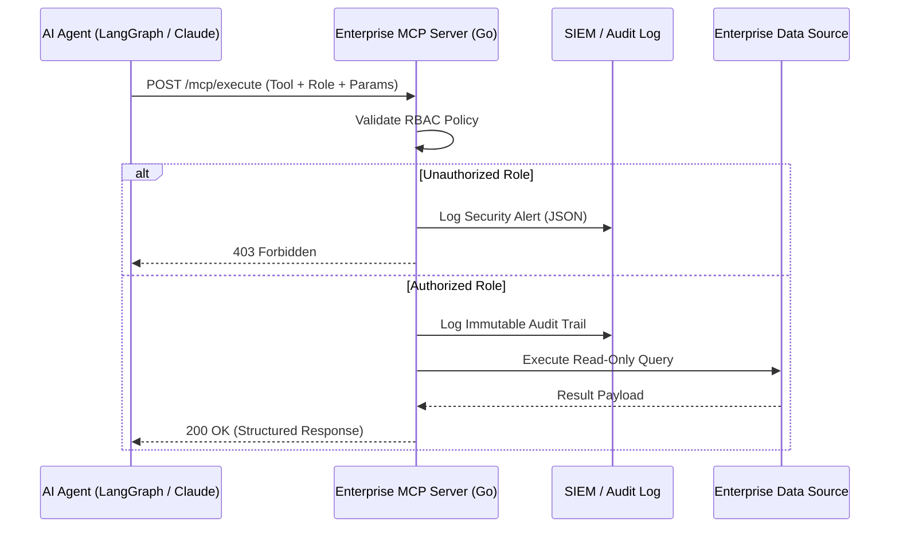

# Enterprise MCP Server Blueprint (Go)

[](https://github.com/defrox/enterprise-mcp-server/actions/workflows/ci.yml)
[](https://go.dev/)
[](https://owasp.org/)

A production-grade **Model Context Protocol (MCP)** server written in **Go**, engineered for enterprise environments requiring strict **Role-Based Access Control (RBAC)**, immutable structured audit logging, and low-latency tool execution for autonomous AI agents.

## Architecture



## Key Features
* **Zero-Trust RBAC Enforcement:** Blocks unauthorized tool invocations at the gateway boundary before touching downstream data systems.
* **SIEM-Ready Structured Logging:** Outputs JSON audit events via Go's `log/slog` with tool name, caller role, and UTC timestamps.
* **Cloud-Native Footprint:** Minimal memory overhead and multi-stage distroless Docker build ready for Kubernetes.

## Quickstart

```bash
# Run locally
go run ./cmd/server

# Test an authorized tool execution
curl -X POST http://localhost:8080/mcp/execute \
  -H "Content-Type: application/json" \
  -d '{"tool": "query_analytics", "role": "ai-analyst", "params": {"limit": 10}}'
```

## Author
**Christian Axel Schmidt** — Principal AI & Systems Architect
